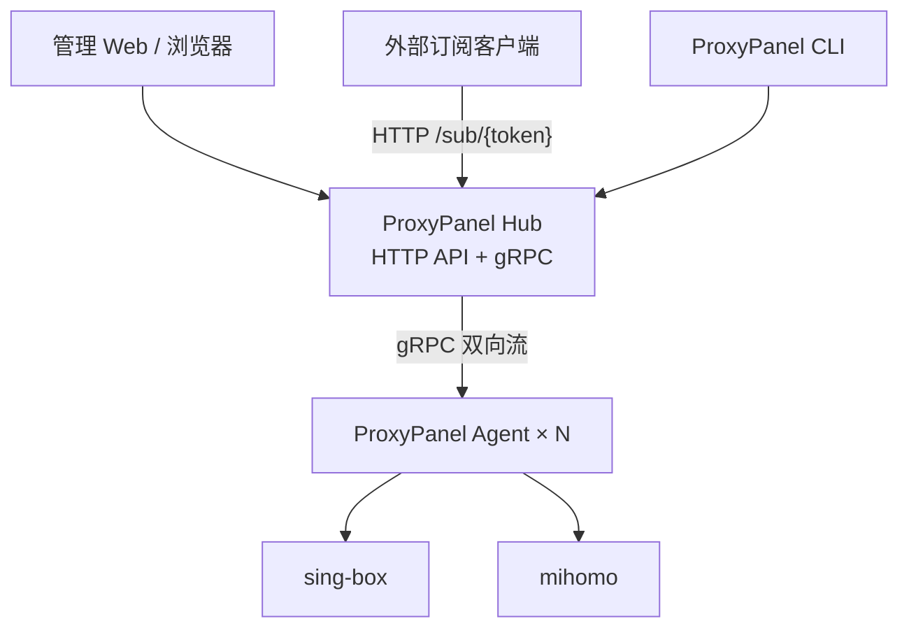
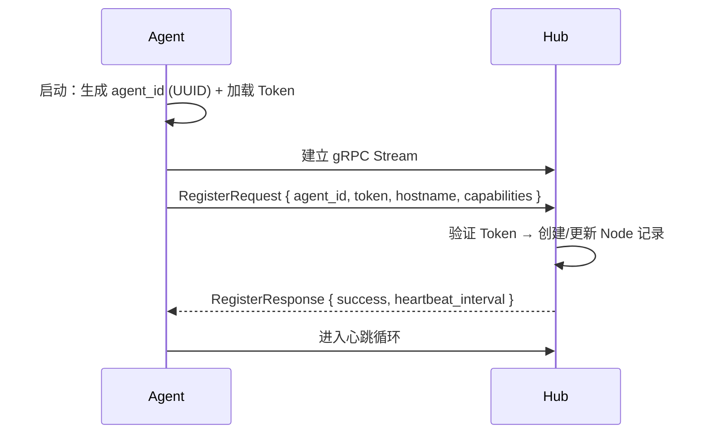
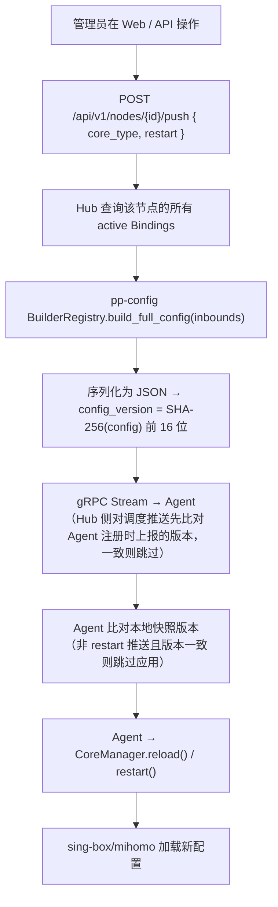
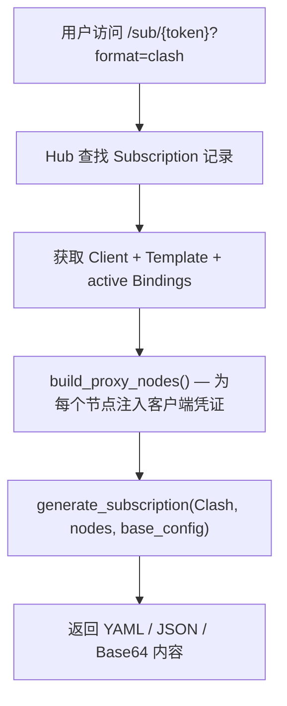
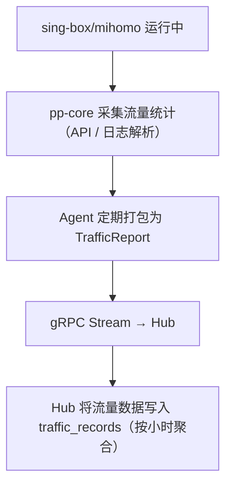
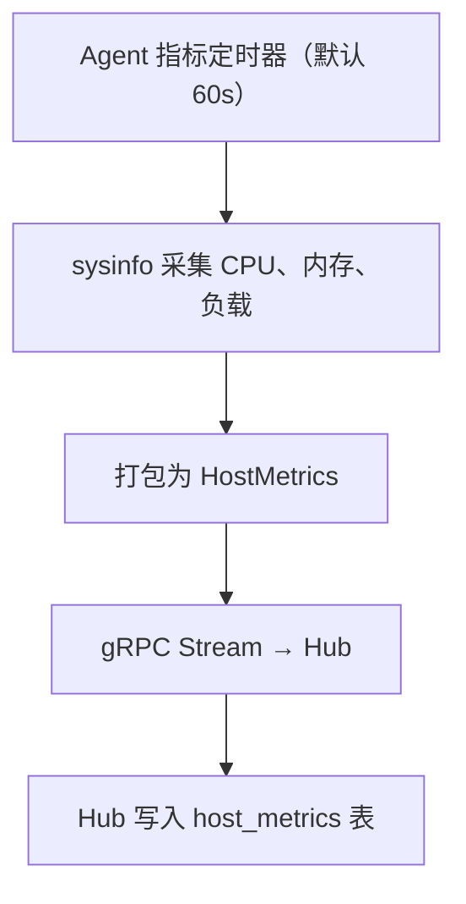
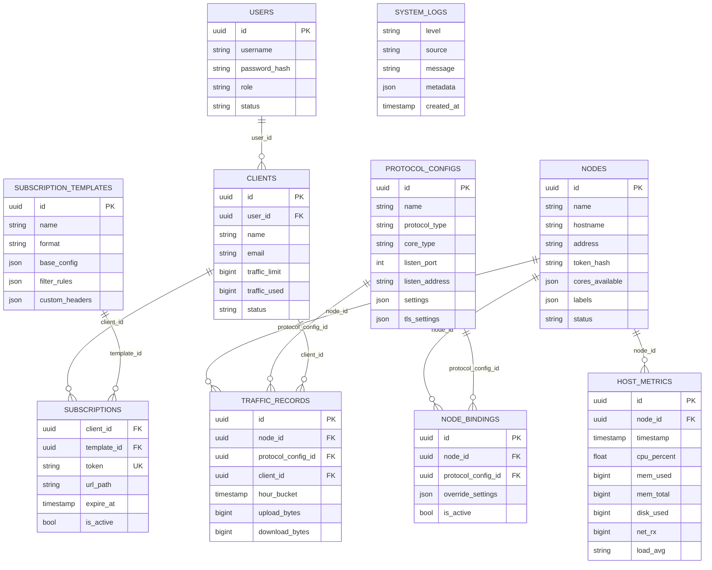

# ProxyPanel 架构文档

本文档描述 ProxyPanel 的整体架构、组件交互、数据流和关键技术决策。

---

## 目录

1. [整体架构](#整体架构)
2. [组件详解](#组件详解)
3. [数据流](#数据流)
4. [产品边界](#产品边界)
5. [数据库设计](#数据库设计)
6. [通信协议](#通信协议)
7. [安全模型](#安全模型)
8. [扩展点](#扩展点)
9. [性能考量](#性能考量)

---

## 整体架构

ProxyPanel 采用 **Hub-Agent** 分布式架构，包含 Hub、节点 Agent、管理 Web 与 CLI。
用户通过 Web 管理节点；外部订阅客户端通过公开订阅端点获取代理配置。



### 设计原则

- **无状态 Hub**: Hub 不保存运行时状态（除 Agent 连接句柄外），所有持久化数据存入数据库
- **自治 Agent**: Agent 在断连后可独立运行，重连后自动同步状态
- **配置即代码**: 协议配置存储为结构化 JSON，通过 Builder 模式转译为特定核心的配置格式
- **插件化协议**: 新增协议只需实现 `ConfigBuilder` trait，无需修改 Hub 核心逻辑

---

## 组件详解

### pp-hub — 中央管理面板

Hub 是系统的控制平面，提供三种服务：

| 服务 | 协议 | 端口 | 说明 |
|------|------|------|------|
| REST API | HTTP/1.1 | 8081 (默认) | 管理操作、查询接口 |
| gRPC | HTTP/2 | 50052 (默认) | Agent 长连接、双向流通信 |
| Web App | HTTP/1.1 | 8081 (同 API) | 静态文件服务，SPA 回退 |

**内部模块：**

```
pp-hub/
├── src/
│   ├── main.rs              # 入口：启动 HTTP + gRPC 双服务
│   ├── state.rs             # AppState：共享状态（DB + Agent 连接表）
│   ├── grpc/
│   │   └── agent_service.rs # HubAgent gRPC 服务实现
│   ├── middleware/
│   │   └── auth.rs          # JWT / Token 认证中间件（预留）
│   ├── routes/              # HTTP 路由处理器
│   │   ├── nodes.rs         # 节点 CRUD + 配置推送
│   │   ├── protocol.rs      # 协议配置 CRUD + REALITY 密钥生成
│   │   ├── client.rs        # 客户端（用户）管理
│   │   ├── bindings.rs      # 节点-配置绑定
│   │   ├── subscription.rs  # 订阅模板 + 订阅管理 + 公开订阅端点
│   │   ├── traffic.rs       # 流量查询
│   │   ├── metrics.rs       # 主机指标查询
│   │   ├── logs.rs          # 系统日志查询
│   │   ├── system_update.rs # Hub 自更新检测/触发（routes/system_update/，见 ADR-0018）
│   │   └── health.rs        # 健康检查
│   └── service/             # 业务逻辑层
│       ├── node.rs          # 节点业务逻辑
│       ├── protocol.rs      # 配置生成服务
│       ├── subscription.rs  # 订阅业务逻辑
│       └── traffic.rs       # 流量统计服务
```

### pp-agent — 节点代理

Agent 部署在每个代理节点上，负责：

1. **gRPC 连接管理**: 与 Hub 建立双向流，自动重连
2. **核心进程管理**: 发现、启动、停止、重载 sing-box/mihomo
3. **指标上报**: 定时采集并上报主机 CPU、内存、网络、负载
4. **流量上报**: 从核心进程获取并上报流量统计
5. **日志上报**: 收集核心日志并批量上报

**内部模块：**

```
pp-agent/
├── src/
│   ├── main.rs              # 入口：参数解析、Token 加载、启动客户端
│   └── client.rs            # AgentStreamClient：gRPC 连接、重连、消息处理
```

### pp-web — Web 前端

基于 React 的响应式单页应用（SPA）：

- **技术栈**: React 19 + TypeScript + Vite 8 + shadcn/ui（Base UI）+ Tailwind CSS v4 + react-i18next（国际化）
- **构建目标**: 静态 JavaScript / CSS 资源（由 Hub 或 CDN 托管）
- **通信方式**: 通过 Axios 调用 Hub REST API

**页面结构：**

| 路由 | 页面 | 功能 |
|------|------|------|
| `/` | Dashboard | 全局概览、统计卡片、节点状态、最近日志 |
| `/nodes` | Nodes | 节点列表、创建、删除、状态监控、父节点配置 |
| `/protocols` | Protocols | 协议配置管理、REALITY 密钥生成 |
| `/bindings` | Bindings | 节点与协议配置的绑定关系 |
| `/clients` | Clients | 客户端（用户）管理、流量配额、on-hold 状态 |
| `/groups` | Groups | 用户组管理 |
| `/subscriptions` | Subscriptions | 订阅模板与订阅链接管理 |
| `/hosts` | Hosts | 主机设置与变量管理 |
| `/metrics` | Metrics | 主机性能指标图表 |
| `/traffic` | Traffic | 实时与历史流量查询 |
| `/onlines` | Onlines | 在线用户列表 |
| `/logs` | Logs | 系统日志查看与筛选 |
| `/api-keys` | ApiKeys | Bootstrap 与管理 API Key |
| `/webhooks` | Webhooks | Webhook 事件接收配置 |

### pp-core — 核心进程管理

提供 sing-box 和 mihomo 的统一管理抽象：

```rust
/// 核心管理器接口
trait CoreManager: Send + Sync {
    fn core_type(&self) -> CoreType;
    async fn start(&self, config: &Value) -> PanelResult<()>;
    async fn stop(&self) -> PanelResult<()>;
    async fn restart(&self, config: &Value) -> PanelResult<()>;
    async fn reload(&self, config: &Value) -> PanelResult<()>;
}

/// 节点上的核心监管器
struct CoreSupervisor {
    managers: RwLock<HashMap<CoreType, Arc<dyn CoreManager>>>,
}
```

**功能：**
- 自动发现系统中的 sing-box/mihomo 二进制文件（缺失时按需从 GitHub Releases 下载安装）
- 通过子进程管理核心生命周期
- 配置文件变更监听（`notify` crate）
- 流量统计采集（通过核心提供的 API / 日志解析）

### pp-config — 配置构建器

将数据库中存储的通用协议配置转译为 sing-box 可识别的 JSON 配置（mihomo 配置同样以 JSON 形式在 Hub↔Agent 间传输，由 Agent 侧的 `MihomoProcessManager` 在落盘时序列化为 `mihomo.yaml`）。

**架构：**

```rust
trait ConfigBuilder: Send + Sync {
    fn core_type(&self) -> CoreType;
    fn build_inbound(&self, protocol: ProtocolType, settings: &Value, tls: Option<&Value>) -> PanelResult<Value>;
    fn build_full_config(&self, inbounds: &[InboundConfig]) -> PanelResult<Value>;
}
```

**实现：**
- `SingBoxConfigBuilder`: 生成 sing-box 配置
- `MihomoConfigBuilder`: 生成 mihomo 配置（listeners 结构；vless 用户为列表、hysteria2/anytls 用户为映射；TLS 支持托管证书（agent 内置 ACME 统一目录）或显式证书文件；内置 ACME 为 sing-box 专属）

**BuilderRegistry**: 运行时注册表，支持按核心类型查找对应的构建器。

### pp-subscription — 订阅生成器

将标准化的代理节点列表序列化为各种客户端支持的订阅格式。

**支持的格式：**

| 格式 | 内容类型 | 典型客户端 |
|------|----------|-----------|
| Base64 | `text/plain` | V2RayN、V2RayNG、Shadowrocket 等分享链接客户端 |
| JSON | `application/json` | 通用节点数组，供调试和二次处理，不是独立客户端订阅格式 |
| Clash | `application/x-yaml` | Clash/mihomo 客户端 |
| SingBox | `application/json` | sing-box 配置 |
| V2RayNG | `text/plain` | 与 Base64 输出相同的分享链接 |

**凭证注入：**

订阅生成时会自动将客户端的 UUID/Email/Password 注入到节点配置中，实现"一链一用户"。

### pp-db — 数据库层

基于 Sea-ORM 的数据库抽象层：

- **连接管理**: 支持 PostgreSQL 和 SQLite
- **迁移系统**: 使用 `sea-orm-migration`，版本化 schema 变更
- **实体定义**: 手写实体匹配迁移 schema（生产环境建议使用 `sea-orm-cli generate entity`）

### pp-common — 共享基础设施

所有 crate 共享的基础模块：

- `models.rs`: DTO（NodeDto、ProtocolConfigDto、ClientDto）
- `protocol.rs`: 枚举（ProtocolType、CoreType、NodeStatus、UserStatus）
- `crypto.rs`: 加密工具（Token 生成、UUID、X25519 密钥对）
- `error.rs`: 全局错误类型 `PanelError` / `PanelResult<T>`

### pp-proto — gRPC 协议

由 `tonic-build` 从 `proto/hub_agent.proto` 自动生成的 Rust 代码。

---

## 数据流

### 3.1 节点注册流程



### 3.2 配置推送流程



### 3.3 订阅服务流程



### 3.4 流量上报流程



### 3.5 主机指标上报流程



---

## 产品边界

[ADR-0015](adr/0015-lanpath-independent-repository.md) 确认客户端独立维护。
用户侧客户端 [岚径 · Lanpath](https://github.com/ybakiame/lanpath) 的源码、UI、Tauri 壳、
Go 引擎和发布配置由新仓拥有，ProxyPanel 无客户端构建依赖。
两产品通过公开订阅/API 协作，版本和发布互不绑定。

`pp-common` 与 `pp-core` 保留在服务端，分别提供共享类型/错误/进程工具以及 Agent 的
sing-box/mihomo 安装、运行和监督能力；客户端已提取自己的实现，不跨仓同步源文件。
服务器的用户实体 `clients` 与 `/api/v1/clients` 仍是账户、配额和订阅管理能力，
与已移出的用户设备应用无关。

---

## 数据库设计

### E-R 关系图



### 表说明

| 表名 | 说明 | 关键索引 |
|------|------|----------|
| `users` | 系统用户（管理员） | `username` (unique) |
| `nodes` | 代理节点 | `status`, `last_seen_at` |
| `protocol_configs` | 协议入站配置 | `protocol_type`, `core_type` |
| `node_bindings` | 节点与配置的绑定关系 | `node_id`, `protocol_config_id` |
| `relay_rules` | 服务端中继路由：入口节点按规则集/域名分流到出口绑定 | `node_id`, `enabled` |
| `node_pending_updates` | 节点待更新脏标记：协议/绑定/中继/版本变更写入，手动推送后消除 | `node_id`, `core_type`, `update_type` |
| `clients` | 代理客户端（最终用户） | `user_id`, `status` |
| `subscription_templates` | 订阅输出格式模板 | — |
| `subscriptions` | 客户端订阅记录 | `token` (unique) |
| `traffic_records` | 流量统计（按小时聚合） | `hour_bucket`, `node_id` |
| `host_metrics` | 主机性能指标 | `node_id`, `timestamp` |
| `system_logs` | 系统/Agent 日志 | `source`, `created_at` |

---

## 通信协议

### gRPC 双向流 (`proto/hub_agent.proto`)

**服务定义：**

```protobuf
service HubAgent {
  rpc Stream(stream AgentMessage) returns (stream HubMessage);
}
```

**Agent → Hub 消息类型：**

| 消息 | 触发条件 | 频率 |
|------|----------|------|
| `RegisterRequest` | 连接建立 | 每次连接 |
| `Heartbeat` | 定时 | 默认 30s |
| `TrafficReport` | 定时 | 默认 60s |
| `HostMetrics` | 定时 | 默认 60s |
| `LogBatch` | 日志积累或定时 | 批量 |
| `CoreStatusReport` | 状态变化 | 事件驱动 |

**Hub → Agent 消息类型：**

| 消息 | 触发条件 | 效果 |
|------|----------|------|
| `RegisterResponse` | 收到注册请求 | 确认注册，分配 ID |
| `ConfigPush` | 管理员推送配置 | 写入并重启/重载核心 |
| `ConfigReload` | 热重载请求 | 仅重载不重启 |
| `CoreCommand` | 核心控制命令 | 启动/停止/重启核心 |
| `AgentShutdown` | 远程关机指令 | 延迟后退出进程 |

### HTTP REST API

详见 [api_reference.md](api_reference.md)。

---

## 安全模型

### 认证机制

| 层级 | 机制 | 状态 |
|------|------|------|
| Agent → Hub | Token 预共享密钥 | ✅ 已实现 |
| Web → Hub | JWT Bearer Token | 🚧 预留（middleware/auth.rs） |
| 订阅端点 | URL Token (随机字符串) | ✅ 已实现 |

### Token 安全

- Agent Token: 32 bytes 加密安全随机数，Base64 编码（43 字符）
- 订阅 Token: 同上，独立生成
- REALITY 私钥: X25519 静态密钥，Base64 编码

### 传输安全

- 生产环境应在 Hub 前部署 TLS 终止（Nginx / Caddy / Cloudflare）
- gRPC 支持 TLS（Tonic 已配置 `tls-ring` feature）
- Agent 与 Hub 的 gRPC 连接建议通过内网或 VPN

### Hub 自更新的 root 边界

Hub 进程以非特权 `proxypanel` 用户运行，面板的 Hub 自更新（`/api/v1/system/update*`，
`system:read` / `system:write` scope）**不直接执行升级**：默认关闭
（`maintenance_enabled=false`），仅返回检测结果与手动命令；管理员可选安装受限
sudoers 规则 + `NoNewPrivileges=false` drop-in 后，Hub 经受限 sudo 以 transient
systemd unit 调用 CLI 完成升级（详见 [ADR-0018](adr/0018-hub-self-update-maintenance.md)）。
升级执行、备份与失败恢复全部在 CLI（root）内完成；状态文件供 Hub 重启后恢复。
本版本不提供 Agent 远程升级，Agent 升级需节点本地 root 执行 CLI。

---

## 扩展点

### 添加新的代理协议

1. 在 `ProtocolType` 添加变体
2. 在 `pp-config` 的 sing-box/mihomo builder 中实现 `build_inbound`
3. 在 `pp-subscription` 各格式中实现节点序列化
4. 在 `validate_protocol` 中注册核心兼容性

### 添加新的订阅格式

1. 实现 `fn generate(nodes: &[ProxyNode]) -> PanelResult<String>`
2. 在 `SubscriptionFormat` 添加变体
3. 在 `generate_subscription` 中添加分发分支

### 添加新的核心类型

1. 在 `CoreType` 添加变体
2. 实现 `CoreManager` trait
3. 在 `CoreSupervisor::discover` 中添加发现逻辑
4. 在 `BuilderRegistry` 中注册对应的 `ConfigBuilder`

---

## 性能考量

- **数据库连接池**: Sea-ORM 内部管理，默认大小适应 Tokio 线程池
- **Agent 连接数**: 内存 HashMap 存储，单 Hub 可支撑数千节点
- **流量聚合**: 按小时桶聚合，避免单条记录过多
- **日志批量**: Agent 端批量上报，减少 gRPC 消息数量
- **配置缓存**: Hub 可缓存生成的配置 JSON，减少重复构建

### 运行日志持久化

Hub 的应用级 INFO/WARN/ERROR tracing 事件通过容量 512 的非阻塞队列异步写入
`system_logs`，启动早期事件在数据库就绪前缓冲，退出时最多等待 5 秒排空。
SQL/HTTP 调试事件不持久化；队列满、数据库写入失败时保留终端告警，不递归记录写入错误。
Agent 经认证 gRPC 上报的事件保存在 `agent_logs`；中心日志接口以 `kind=system|agent`
区分查询，沿用 `logs:read` 权限与现有清理任务。消息和结构化字段做常见凭据脱敏及长度限制。
参见 [ADR-0016](adr/0016-central-log-persistence.md)。
